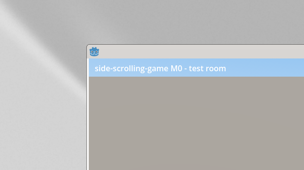

# side-scrolling-game

Custom tribute to Elsword: an open-source, **Elsword-inspired 2.5D action brawler**. 3D models and environments, seen from a side-scrolling camera, built around Elsword's combo feel.

- **First character:** a Rena-style elf ranger with kicks, arrows and a short blade: the `ZZZ<<>` run-cancel loop, the `>>ZX` slide-kick slash-through, air juggles managed by a KD (knockdown) gauge.
- **First content:** a training room, one dungeon (rooms, small platforms, a mini-boss, a boss, an end-of-run S+/S/A rank), one town with NPCs, dialogue and shops.
- **Real goal:** online co-op dungeon parties, then channel-based towns and hunting fields.
- **Platforms:** macOS first, Windows later. Free and open-source tools only.
- **Controls:** keyboard, Elsword-style (Z/X + arrows + skill keys). Works out of the box on **QWERTY and AZERTY** (keys are bound by physical position).

> Status: **M0 (vertical slice) in progress.** The Godot project and its test setup exist; there is no gameplay yet. Track progress in [epic #35](https://github.com/asty8926/side-scrolling-game/issues/35).

## How to try it (macOS)

No coding needed. You only install Godot once.

1. **Install Godot 4.7.2** (free): download "Godot Engine - macOS" for **4.7.2-stable** from the [official release page](https://github.com/godotengine/godot/releases/tag/4.7.2-stable) (file `Godot_v4.7.2-stable_macos.universal.zip`), unzip it and drag `Godot.app` into Applications. Use exactly this version: newer or older ones may change things.
2. **Get the project**: on this GitHub page click **Code > Download ZIP** and unzip it (or `git clone` it).
3. **Open it**: start Godot, click **Import**, pick the `project.godot` file in the unzipped folder, then **Import & Edit**. The first opening takes a few seconds while Godot imports files.
4. **Run the project**: press **F5** (on a Mac keyboard you may need **fn + F5**), or click the ▶ Play button at the top right. A window opens on the **test room**: a floor, wooden platforms stacked exactly one jump apart, and a blue capsule (you) whose yellow nose shows which way it faces. Click inside the window once so it gets the keyboard, then use the keys below. Close the window (or press **F8** in the editor) to stop.

What to try:
- Walk with ← →; double-tap → (or ←) to dash, keep holding to keep dashing.
- While dashing, tap the opposite arrow once: you stop and turn around.
- ↑ jumps up one platform; ↑ again in the air (double jump) reaches two.
- ↓ while standing on a platform drops through it.
- The camera follows sideways once you leave the middle of the screen, and stops at the room walls.
- A grey training dummy stands 1 m in front of you. Press **W** (AZERTY; **Z** on QWERTY) up to 4 times for the 4-kick string `ZZZZ`, or **X** up to 4 times for the arrow string `XXXX` (W/Z attacks are kicks; X attacks shoot real arrows that fly across the room, shown in pink, and hit the first character they touch; the third X shoots two). Mashing early is fine (the press is buffered); pressing too late ends the string. The orange box shows where a kick can hit, only on its active ticks. Above the dummy: its HP, KD gauge, combo counter (hits landed while it is still in hitstun), last hit damage and remaining hitstun. Kicks and arrows both push it back a little in the direction of the hit. **F4** (Mac: **fn + F4**) resets the dummy.



### Keys

Keys are bound by **physical position**, so they work on QWERTY and AZERTY with no setup. The bottom of the window shows the labels for *your* keyboard layout.

| Action | QWERTY key | French AZERTY key |
|---|---|---|
| Primary attack (`Z` in the docs) | Z | **W** |
| Secondary attack (`X`) | X | X |
| Walk / dash (double-tap) | ← → | ← → |
| Jump / double jump | ↑ | ↑ |
| Drop through a platform | ↓ | ↓ |
| Skills 1-4 | A S D C | **Q** S D C |
| Awakening | Left Ctrl | Left Ctrl |
| Record a replay (debug); a red **REC** shows top right while recording | F9 | F9 (Mac: **fn + F9**) |
| Reset the training dummy (debug) | F4 | F4 (Mac: **fn + F4**) |

Double-tap window and input buffer are in `data/input_settings.tres` (open it in Godot's FileSystem dock, edit in the Inspector).

### Change the room or the movement

Everything is a data file you edit in the Inspector (double-click it in the FileSystem dock, change a value, press **Ctrl+S** / **Cmd+S**, then F5 again):

- `data/rooms/test_room.tres`: walls, floor and the **Platforms** list (x position, tier = how many jumps up, width, thickness). Add or move a platform and both what you see and what you can stand on change.
- `data/characters/ranger_moves.tres`: every attack of the `ZZZZ` and `XXXX` strings. Each move has its frame data (startup, active, recovery ticks), its kick hitboxes (position, size, which ticks they are active) or its arrows (**Projectiles**: spawn tick, spawn offset, speed in sub-units per tick, lifetime, size), damage %, hitstun, KD, and which move it cancels into and when. A mistake (for example a hitbox active outside the move's active ticks) is reported with a clear message when the game starts.
- `data/characters/ranger.tres` / `dummy.tres`: HP, attack and the hurtbox (where the character can be hit).
- `data/characters/ranger_movement.tres`: walk and dash speed, jump strength, gravity. Platform tiers follow the jump height, so they stay one jump apart.
- **Live tuning (no restart):** while the game runs (F5), change a value in one of these files and save (Cmd+S). Within half a second the game uses it: the next kick hits with the new damage, hitstun or hitbox, and arrows (even one already flying) use the new speed. A green message confirms it. A broken value (for example `active = -3`) shows a red message listing the problem, and the game keeps the previous values. Edit the file again to fix it. (Live reload is for debug runs only. A replay recorded while you edit data won't play back the same.)
- Camera feel: click the **SideCamera** node in `game/main.tscn` and tune distance, height, dead zone and smoothing in the Inspector.

### Run tests

- **In the editor:** open the **GUT** tab at the bottom of the window. The first time, open its settings (gear icon) and add `res://test` as a test directory with *Include Subdirectories* on. Then click **Run All**.
- **From a terminal** (from the project folder; on macOS replace `godot` with `/Applications/Godot.app/Contents/MacOS/Godot`):

  ```sh
  godot --headless --import && godot --headless -s res://tools/check_scripts.gd && godot --headless -s addons/gut/gut_cmdln.gd -gdir=res://test -ginclude_subdirs -gexit
  ```

  The first command imports the project, the second fails if any of our scripts breaks the strict typing rules, the third runs the tests. GitHub Actions runs the same three steps on every push and pull request ([CI workflow](.github/workflows/ci.yml)).

### Record a replay and turn it into a test

Every combat feature ships with an input-replay test (same inputs, same result, checked in CI).

1. Press **F5** to play, then **F9** to start recording. Play, then **F9** again to stop.
2. The Output panel prints `ReplayRecorder: saved N ticks to .../replays/<date>.tres` (macOS: `~/Library/Application Support/Godot/app_userdata/side-scrolling-game/replays/`).
3. Copy that file into `test/replay/fixtures/` and add a test next to `test/replay/test_example_replay.gd` (one line: `assert_replay("res://test/replay/fixtures/<file>.tres")`).

If a change to the game rules is intentional, the replay test fails with the expected vs actual hash and the first tick where they differ: record again (or rerun `godot --headless -s res://tools/make_example_replay.gd` for the scripted example).

## Project layout

| Folder | What lives there |
|---|---|
| `game/` | Scenes and scripts of the game. `game/main.tscn` is the scene that opens when you press Play. |
| `game/sim/` | The deterministic combat simulation: plain typed GDScript, no nodes, no scene tree, integer math only (1 m = 1000 sub-units), 60 ticks per second, seeded RNG, hashable snapshots. Rules: [game/sim/README.md](game/sim/README.md). `game/sim_driver.gd` steps it once per physics tick. |
| `game/view/` | 3D display: reads the simulation state and draws it (never changes it). |
| `game/input/` | Keyboard to per-tick input frames (`InputSampler`), key labels for your layout (`KeyLabel`). |
| `game/replay/` | Replays: the `Replay` file format, `ReplayRunner` (runs one headless), `SimSetup` (named ways to build a world). |
| `game/debug/` | Debug tools: replay recorder (F9), later overlays and readouts. |
| `data/` | Game data as text Resources (`.tres`), editable in Godot's Inspector: `input_settings.tres` (double tap, buffer), `characters/ranger_movement.tres` (walk/dash speed, jump, gravity), `rooms/test_room.tres` (walls, floor, platforms by tier). |
| `test/unit/`, `test/replay/` | GUT tests: unit tests and input-replay tests, run headless in CI. |
| `tools/` | CI helper scripts (`check_scripts.gd` fails the build on any script error). |
| `addons/` | Vendored third-party add-ons only ([GUT 9.7.1](https://github.com/bitwes/Gut/releases/tag/v9.7.1)). Excluded from our strict warnings. |
| `docs/` | Design docs and reference images. Godot ignores this folder (`docs/.gdignore`). |

Renderer: **Forward+** (Godot's default desktop renderer, the best fit for 3D on an Apple Silicon Mac). CI runs with `--headless`, which skips rendering entirely, so the renderer choice does not affect tests.

## Stack (decided: [ADR 0001](docs/decisions/0001-engine-godot.md))

- **[Godot 4.7](https://godotengine.org/)** (pinned to 4.7.2-stable), free and open source. Its editor gives us room/platform layout, an inspector for every tunable number, and an animation timeline without building our own editors.
- **Strictly typed GDScript**: untyped declarations and unsafe access are compile errors (project settings). All code is written by AI coding agents (Grok Bot and Cursor agents).
- **Deterministic fixed-tick combat simulation** (60 ticks/s, integer fixed-point state, per-tick input frames, seeded RNG, state hash + input-replay tests) from day one, so online co-op doesn't need a rewrite. Godot's physics engine is never used to decide combat outcomes.
- **Data as Godot Resources (`.tres`)**: moves, hitboxes, enemies, rooms, shops, dialogue. Editable in the inspector (with custom inspector panels where it helps) and as plain text by agents. Move data hot-reloads while the game runs.
- **Free add-ons only where they save real work**: GUT for tests, Dialogue Manager for dialogue (M3). See [ADR 0002](docs/decisions/0002-addons-and-tooling.md).
- **Later:** a dedicated headless Godot server for online co-op, [Nakama](https://heroiclabs.com/nakama/) for accounts/parties/matchmaking, and Rust via [godot-rust/gdext](https://github.com/godot-rust/gdext) only for a measured hot spot.
- **Builds:** macOS first (unsigned: right-click > Open or "Open Anyway" once in Privacy & Security), Windows later.
- AI-generated 3D models and animations (glTF), with Blender scripting available. Premade assets are placeholders only.

## Docs

- [docs/README.md](docs/README.md): start here (index, which doc to read when, Elsword glossary)
- [docs/vision.md](docs/vision.md): goals and constraints
- [docs/roadmap.md](docs/roadmap.md): milestones M0-M5, the determinism rule, scope guardrails
- [docs/decisions/](docs/decisions/): architecture decision records (engine, add-ons)
- [docs/systems/](docs/systems/): one doc per system (KD, combos, Awakening, dungeons, town, co-op...)
- [AGENTS.md](AGENTS.md): rules for AI coding agents

## License

Code: [MIT](LICENSE). Reference images in `docs/images/` are © KOG Studios and partners and are not covered by the MIT license (see [docs/images/README.md](docs/images/README.md)). This is a fan-made, non-commercial project, not affiliated with KOG, Nexon or Gameforge.
