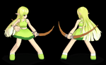
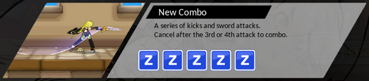

# Basic combos and command inputs

> Tracking issue: [#1](https://github.com/asty8926/side-scrolling-game/issues/1) · Milestone epic: [#17](https://github.com/asty8926/side-scrolling-game/issues/17)

## Notation used in all docs

ElWiki writes commands with key icons. We use this text notation everywhere (issues, data files, code comments):

| Notation | ElWiki icon | Meaning (character facing right) |
|---|---|---|
| `Z` |  | Primary attack key (Rena: kicks). AZERTY physical key: **W** |
| `X` |  | Secondary attack key (Rena: arrows / Erendil). Same physical key on AZERTY: **X** |
| `→` / `R` |  | Right arrow (forward). Hold = walk |
| `←` / `L` | | Left arrow (backward) |
| `↑` / `U` |  | Up arrow = jump (one platform of height) |
| `↓` / `D` | | Down arrow = drop through platform / down-variants |
| `>>` / `→→` / `DR` |  | Double-tap forward = **dash/run** |
| `<<` / `DL` | | Double-tap backward = dash backwards (turns the character around) |
| `>>↑` / `DRU` |  | Jump while dashing ("dash jump") |
| `↑↑` / `UU` |  | Double jump (Rena has one) |
| `↑Z`, `↑X` |  | Press Up together with the attack key at the end of a string (launcher / up-variant) |
| `HoldZ` | | Hold the key |
| `(pause)` | | Wait briefly before the next input |
| `Z Z Z` | | Successive presses, each continuing the string |

Asty writes the same moves in AZERTY letters: **`W` = `Z`**, so his `WWW<<>` is ElWiki's `ZZZ<<>` and his `>>WX` is ElWiki's `>>ZX` (→→ZX).

## What it is in Elsword

From ElWiki "Commands" (short quotes):

- "Commands are the basic moves that can be executed by characters... All commands use a combination of the [→], [←], [↓], [↑], [Z] and [X] keys."
- Commands that cost no MP "tend to be used to quickly restore it instead" (see [08-mp-economy.md](08-mp-economy.md)).
- Movement: hold → / ← to walk; "tapping the respective key twice... will cause you to start running faster." Jump `↑` moves you "up by a single platform in height", and "most dungeon layouts are essentially layered in height by multiple platforms exactly one jump apart." `↓` on a platform drops down. A "high jump" exists by tapping `>>↑` then `←` quickly.
- Dash commands ("Dash" / "Dash Jump" commands) can only be performed while dashing or after jumping during a dash.
- Some commands **pass through** enemies (e.g. Elsword's `>>ZZZ`), which is a movement tool, and ElWiki's KD table marks those as type **P** (pass).
- ElWiki's Hitstun/Launch/Knockback subsections on the Commands page are **empty stubs** ("Explanation of hitstun and its various intensities."), so there is no official data on hitstun durations.

### Rena (base) command list, verbatim damage from ElWiki

All percentages are of physical/magical attack. "(nMP)" next to arrows is most likely the arrow's **MP cost** (the Rena page says "As Rena's arrows require MP, Rena can also regenerate MP"; the table itself does not label the column, so treat as to-verify). Kicks cost nothing and, like all hits, give MP. See [08-mp-economy.md](08-mp-economy.md).

| Command | Description (ElWiki, shortened) | Damage per input |
|---|---|---|
| `ZZZZ` | "Basic 4 kick combo that launches enemies away on the final hit." | 163% / 201% / 249% / 339% |
| `ZZZ↑Z` | 3 kicks, "followed by an upper kick that launches the target." | 163 / 201 / 249 / 320% |
| `ZZZX` | 3 kicks, "followed by a quick dodge behind targets and an arrow shot that knocks down." | ... / X 380% Mag (6MP) |
| `XXXX` | 2 arrows, backflip + 2 arrows, final shot that knocks down. Arrows pierce one target. | 261 (2MP) / 295 (3MP) / 165x2 (6MP) / 468 (3MP) |
| `XXX↑X` | ... ends with an upward 3-arrow shot. | last: 123% x3 (15MP) |
| `XXX↓X` | ... ends with a downward 3-arrow shot. | last: 123% x3 (12MP) |
| `↑Z` | Single jump kick. | 176% |
| `↑X` | Jump arrow "without knocking down". | 272% Mag (2MP) |
| `>>ZZ` | "Slide to kick and launch the target." | 173% / 228% |
| `>>X` | "Dodge behind targets and shoot an arrow." (pass-through hit added 2019) | 100% Phy + 278% Mag (2MP) |
| `>>↑Z` | Mid-air forward kick; keeps running after landing if → held. | 188% |
| `>>↑XXX` | 2 mid-air arrows + a 3-arrow shot. | 284 / 295 / 141x3 |
| `↑↑Z` | Double-jump diving kick, no knockdown, shockwave on landing. | 100% + 182% |
| `↑↑X` | Double-jump 3 spread arrows downward, no knockdown, shockwave on landing. | 93% x3 (2MP) + 182% |
| Recovery `Z`/`X` | "spinning handstand kick" when getting up; no longer knocks down (2017). | 132% |

Important history: before the **06/20/2019 (KR) / 07/17/2019 (NA)** patch, Rena's `ZZZZ` final hit **knocked down**; that patch made it "launch forward instead of knocking down" and "adjusted command responsiveness to allow for less restrictive movement." Asty's memory (4th hit = KD) matches the **classic** behavior. We follow the classic behavior (see [03-combo-loops-and-cancels.md](03-combo-loops-and-cancels.md)).

### Trapping Ranger and Night Watcher additions (the flavor we want)

Trapping Ranger (1st job, "a ranger that uses a sword and magic for combat") reworks some kicks into **Erendil** (a short sacred sword) slashes, several with **Super Armor**:

| Command | ElWiki description (shortened) | Damage |
|---|---|---|
| `ZZZZZ` | Draws Erendil, slashes in Super Armor, second slash, final stab in Super Armor. "Holding [←] or [→] during the 4th [Z] will reset the combo with little to no delay." The final Z "can be interrupted by movement". | 163/201/238/276/121%+171 |
| **`>>ZX`** | "After doing the standard [>>Z] combo, slash through enemies with Erendil, pushing them along with you." KD type **P** (pass). | 173% / 267% |
| `>>↑ZZ` | Erendil thrust, then "slashing again to leap behind enemies." | 197% / 210% |
| `↑↑XX` / `↑↑ZX` | After the double-jump attack, "pierce through the enemy with Erendil upon landing." | ... / 326% |

Night Watcher (2nd job) adds: `ZXXX` (3 heavy sword swings), `>>(pause)→↑ZZ` (catch breath, sprint, leap kick, Super Armor overhead launch), Eldrasil-branch arrows, `>>↑XXZ` dive stomp, and `>>XZ HoldZ` (rush from behind, repeated stabs, "If repeated stabbing is stopped mid-way, the final slash will move you through the enemy"). NW patch 05/29/2014: "Can cancel all [X] inputs earlier by dashing."

The signature `>>ZX` move is detailed in [04-night-watcher-slide-x.md](04-night-watcher-slide-x.md).

### Default keys

- ElWiki confirms **left Ctrl** = Awakening ([06-awakening.md](06-awakening.md)), **V** = Elsword's special action key (Way of the Sword switch), **M** = map, **F8** = start dungeon.
- ElWiki "Skills": "The default keys for these skill slots are A, S, D, C, Q, W, E, and R (And F and T after Transcendence)"; one slot for **Hyper Actives** on **LShift**, one for **Master Skills** on **LAlt**. On AZERTY, binding by physical position means QWERTY `A` is the key labeled **Q**, QWERTY `Q` is labeled **A**, QWERTY `W` is labeled **Z** (exactly what Asty asked: "Z becomes W, Q becomes A").

## Why Asty loves it

> "Keyboard, Elsword-style Z/X plus skill keys." "Important: I use an AZERTY Keyboard, so by default it should work out of the box for qwerty and my keyboard layout so Z becomes W, Q becomes A."

The command list *is* the character. Short strings with branch points (`ZZZ` → `Z` / `↑Z` / `X`) let the player decide every half-second.

## What our version must do (acceptance criteria)

**Input layer**
- [ ] Bindings are stored by **physical key code** (USB HID / scan-code, e.g. `KeyZ`, `KeyX`, `ArrowRight`, `ControlLeft`), not by character. On AZERTY the physical `KeyZ` is labeled **W**, and pressing it performs `Z` with zero configuration.
- [ ] The UI shows the **localized label** of the bound key (shows "W" on AZERTY, "Z" on QWERTY) using the OS layout. Test: switch macOS input source QWERTY ↔ AZERTY (French) and confirm both labels and behavior.
- [ ] Bindings live in one config file (e.g. `config/input.(ron|toml|json)`), validated at load, hot-reloadable; invalid file = error message + keep previous bindings (no crash).
- [ ] Input is sampled every simulation tick (fixed timestep) into a per-player **input frame** (bitset of held buttons + press/release edges). The combat logic only reads input frames (required for replays and netcode, see [roadmap.md](../roadmap.md)).
- [ ] Double-tap detection for `>>`/`<<` with a configurable window (proposal: 12 ticks at 60 Hz, **our number, not Elsword data**).

**Movement**
- [ ] Walk, dash (double-tap), jump of exactly one platform height, double jump, drop-through (`↓`), dash jump. Platform height and jump height are tied by data (one jump = one platform tier).
- [ ] Dashing backward (`<<`) turns the character to face backward; pressing the opposite direction while dashing stops the dash and turns the character (the "reverse" used by `ZZZ<<>`).

**Commands**
- [ ] Commands are defined in **data** (a command tree per character: node = move, edges = input + timing window), not hard-coded. Each move has startup / active / recovery frames, hitboxes per frame, damage %, KD value, hit type (normal / launch / KD / pass), MP gain/cost, super-armor frames, cancel windows.
- [ ] M0 subset: `ZZZZ`, `ZZZ↑Z`, `ZZZX`, `XXXX`, `>>ZZ`, `>>ZX`, `↑Z`, `↑X`.
- [ ] M1: full base list above + the Trapping-Ranger/NW-flavored moves we pick (see open questions).
- [ ] A **command list screen** in game generated from the same data (so it can't get out of sync).

## Open questions

1. Which moves from TR/NW do we keep for our single "best-of" kit? Proposal: base Rena kicks/arrows + TR `ZZZZZ` reset trick + `>>ZX` + `>>↑ZZ` (leap behind) + NW `>>XZ HoldZ`.
2. Default skill keys: copy Elsword's A/S/D/C + Q/W/E/R (physical positions) or reduce to 4 slots for scope? Proposal: 4 slots (A/S/D/C positions) until M4.
3. Should `X` (arrows) cost MP like current Elsword Rena? Small costs (2-15 MP) paid back by kicks create a nice kick→arrow rhythm; decide in M1. See [08-mp-economy.md](08-mp-economy.md).
4. Gamepad: out of scope for now (Asty plays keyboard), but keep the input-frame abstraction gamepad-ready.

## Sources

- ElWiki, Commands: https://elwiki.net/w/Commands
- ElWiki, Rena (Commands section, Updates): https://elwiki.net/w/Rena
- ElWiki, Trapping Ranger (Additional Commands): https://elwiki.net/w/Trapping_Ranger
- ElWiki, Night Watcher (Additional Commands): https://elwiki.net/w/Night_Watcher
- ElWiki, UI Guide (channel/location, party, keys): https://elwiki.net/w/UI_Guide
- ElWiki, Skills (default skill keys, skill categories): https://elwiki.net/w/Skills
- Note: elwiki.net blocks scripted requests (Cloudflare). Pages were read via a fetch tool and via Wayback Machine snapshots (2025-12) to recover input icons that plain text extraction drops.

## Images

| Local | What | Source |
|---|---|---|
| `../images/combat-inputs/Portrait_-_Rena.png` | Rena portrait | https://elwiki.net/w/Rena |
| `../images/combat-inputs/Combat_Pose_-_Rena.png` | Combat stance | https://elwiki.net/w/Rena |
| `../images/combat-inputs/Promotional_Model_-_Rena.png` | Idle pose / promo model (useful 3D reference) | https://elwiki.net/w/Rena |
| `../images/night-watcher-slide-x/Combo_-_Trapping_Ranger_1.png` | In-game "New Combo" card for TR `ZZZZZ` | https://elwiki.net/w/Trapping_Ranger |
| `../images/night-watcher-slide-x/Combo_-_Trapping_Ranger_3.png` | TR `>>↑ZZ` card | https://elwiki.net/w/Trapping_Ranger |
| `../images/input-icons/*.png` | ElWiki key icons (Z, X, DR, DRU, UU, ...) | https://elwiki.net/w/Rena |

