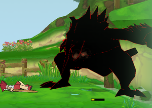

# KD (knockdown) gauge

> Tracking issue: [#2](https://github.com/asty8926/side-scrolling-game/issues/2) · Milestone epic: [#18](https://github.com/asty8926/side-scrolling-game/issues/18) · Research: [#15](https://github.com/asty8926/side-scrolling-game/issues/15)

## What it is in Elsword

ElWiki "Knockdown" (page carries a warning: "has not been updated in a long time and may no longer contain relevant information"; many Season 4 values are blank):

- "Knockdown (abbreviated as KD) occurs when using a certain attack that knocks down or when a certain amount of attacks has been reached. The reason this exists is to prevent infinite combos."
- In PvE, knocking a monster down "leads to reduced damage while the enemy is on the ground"; in PvP it ends the combo.

### Conditions (verbatim numbers)

A target is knocked down automatically when:

1. a **knockdown attack** hits it (move type `KD`), or
2. **any hit after the KD counter limit** is reached: **PvP = 100 max KD, PvE = 130 max KD**.

- The KD counter **resets after a knockdown** caused by maxing the counter.
- If the limit is breached **mid-air**, the target "will fall more quickly."

### Reducing / extending KD

- Some skills/attacks reduce the counter. Example: Sword Knight's active **Kick**: "Kick enemies and reduce their Knockdown rate", **-20 KD** (and "can still knock down your opponent if the KD counter is full"). Elsword's Persistent Roll: **-20**.
- "Most attacks that knockdown... will reduce KD."
- **Launch extension (Season 4):** most vertical launches **extend the cap by 34%** instead of reducing KD, with a decay ("descale"). PvP: cap 134, "15% descale over 2.5 second for the next 15 seconds". PvE: cap **174.2**, "descale of 12.8% over 3.1 seconds for the next 30 seconds". (Wording on the wiki is ambiguous; treat the decay curve as **to verify**.)
- **Season 1 remnant (reset):** at or past the limit, an attack with **two or more hits in the same animation frame** resets the counter to **0**. Wiki example: Ara's standing X is 9.2 KD; 11 X = 101.2; Energy Absorption then resets to 0.

### Move types (wiki legend)

| Code | Meaning |
|---|---|
| `LA` | Launch vertically ("High chance of continuing combo") |
| `LA1` | Launch horizontally left/right |
| `LA2` | Launch horizontally into the air |
| `LA3` | Launch diagonally into the air or ground ("High chance of continuing combo") |
| `P` | Pass: "move you through your opponent" |
| `KD` | Knocks down |
| `R` | "Resets the KD counter when used after the limit has been reached" |

All actives and special actives have **0 KD by default** unless specified. The wiki speculates about **"staling"** in S4: repeated 0-KD moves can still cause KD if spammed.

### Example values (to give scale)

Elsword (base) from the wiki table:

| Input | KD value | Type |
|---|---|---|
| `Z`, `ZZ` | 6.6 each | - |
| `ZZZ` (3rd) | 7.3 | - |
| `ZZZZ` (4th) | R | KD |
| `ZZZX` | +34% counter extension | LA1 |
| `X`, `XX` | 7.4 each | - |
| `>>Z` | 9.2 | - |
| `>>ZZZ` (3rd) | 9.2 | P |
| `↑X` | -34 ~ -42 | KD |

So at PvE cap 130, about **18 basic hits of ~7 KD** fit before forced knockdown; the 4th hit of the basic string knocks down by itself regardless.

**Rena's numeric values are blank on the wiki** (only types): `ZZZZ` = KD (classic), `ZZZ↑Z` = LA3, `ZZZX` = P + KD, `XXXX` = KD, `>>ZZ` = LA, `>>X` = P + KD. Trapping Ranger: `ZZZ` (3rd hit) **15** KD (8.25 with the passive Hunter's Ability Lv.4), `ZZZZ` (4th) **10** (5.5), `ZZZZZ` = KD, **`>>ZX` = P**, `>>↑ZZ` = P, `↑↑XX`/`↑↑ZX` = P. Night Watcher `>>XZ HoldZ (cancel)` = P.

### Related protection mechanics

- **Super Armor** (status effect): "resistance to hitstun/flinching and knockdown, often indicated by a red outline"; may include damage reduction. Granted by many skills and some commands (TR/NW Erendil slashes).
- **Stoic Threshold** (bosses/some monsters): "the number of hits that they could take before they automatically enter Super Armored status." All hits count, even without hitstun; hits during super armor don't count. On reaching it the monster gets brief Super Armor (red outline) and **pushes back and knocks down** nearby targets. Examples (Wally's Underground Laboratory): Royal Guardian 10 hits / 0 s; Infected Rat 20 hits / 2 s; Brutal Fire Cross 30 hits / 5 s.
- **Mana Break** (player escape): with ≥100 MP, hold `Z` or `X` to charge a green bar inside the MP bar; when hit with the bar past the first 100 MP line, you spend that MP and are **forced into knockdown** (escape), with invulnerability that ends on touching ground. "Being knocked down via mana break does not reset your KD counter limit if mana breaking when launched."
- **Knockdown recovery**: Rena has a Recovery `Z`/`X` attack when getting up (132%). Aisha's movement list lists "`←`/`→` Knockdown Recovery".
- **Getting-up invincibility duration: not documented** on pages read. To verify / to design.

## Why Asty loves it

> "KD has a value for each entity at all times and there are combos and skills that increase or decrease it, and when it reaches a certain value, the entity is knocked down on the floor, so they fall and you can't combo them until they come back standing up." "...core to Elsword and very important!"

KD is what turns mashing into a puzzle: the player must spend the gauge wisely and use launches/resets to extend.

## What our version must do (acceptance criteria)

- [ ] Every combat entity has `kd: f32/fixed` (current) and `kd_cap` (base PvE 130 equivalent, in data). Visible in a debug overlay above each entity at all times (number + bar).
- [ ] Each hit definition has `kd_value` (can be negative), `hit_type` ∈ {normal, launch(LA/LA1/LA2/LA3), pass, knockdown, reset}.
- [ ] Rule 1: a `knockdown` hit always knocks down. Rule 2: any hit that lands when `kd >= kd_cap` knocks down. After a cap-induced knockdown, `kd = 0`.
- [ ] Launch hits apply a **temporary cap extension** (data: `+34%`, decay curve) rather than reducing KD, matching the S4 description; parameters in data so we can also emulate "classic" behavior.
- [ ] Knocked-down state: target falls (faster if airborne), lies down for `down_time`, then gets up with `getup_invuln` ticks (our numbers; Elsword's unknown). Optional recovery attack on getup.
- [ ] Damage taken while down is multiplied by `down_damage_mult` (< 1, data). PvE "reduced damage while on the ground" per wiki; exact value unknown.
- [ ] KD decays toward 0 when the target isn't hit for `kd_decay_delay` ticks (**our assumption**; Elsword decay outside launches is not documented). Must be data-toggleable.
- [ ] **Super Armor** flag per frame on moves; super-armored targets take damage but no hitstun, no KD.
- [ ] **Stoic threshold** per monster type in data (hits, super-armor duration, push-back knockdown radius).
- [ ] Unit tests: (a) 18 hits of 7 KD → 19th hit knocks down at cap 130; (b) launch extends cap; (c) reset move at cap sets 0; (d) knockdown hit always KDs.
- [ ] Mana Break: **later milestone** (M2+), needed mainly when monsters can juggle the player.

## Open questions

1. Classic (Season 1) vs Season 4 KD rules? Proposal: S4 rules with data knobs; tune by feel.
2. Should monsters' KD cap differ by monster size (boss vs mob)? Elsword uses stoic thresholds and super armor for bosses instead.
3. Show the KD bar to the player in normal play, or only in debug? Elsword hides it. Proposal: hidden by default, toggle in options ("training mode").
4. Getup invincibility and down time values: need video frame-counting of real Elsword gameplay if we want parity.

## Sources

- https://elwiki.net/w/Knockdown (conditions, legend, tables; Wayback snapshot 2025-12 used for full tables)
- https://elwiki.net/w/Status_Effects/Super_Armor
- https://elwiki.net/w/Stoic_Thresholds
- https://elwiki.net/w/Mana_Break
- https://elwiki.net/w/Kick (-20 KD active)
- https://elwiki.net/w/Commands (movement list: knockdown recovery)

## Images

| Local | What | Source |
|---|---|---|
| `../images/kd-knockdown/Dark_Phoru.png` | Ancient Phoru's red-outline look after reaching its Stoic Threshold | https://elwiki.net/w/Stoic_Thresholds |
| `../images/mp-economy/Manabreak1.jpg` | Mana Break charge bar inside the MP bar | https://elwiki.net/w/Mana_Break |

