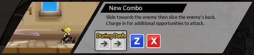
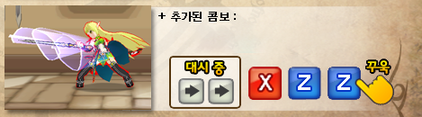

# `>>ZX` (Asty's `>>WX`): slide kick, then slash through

## What it is in Elsword

### Exact name

ElWiki gives this command **no proper name**. It is listed as a Trapping Ranger "Additional Command" with input **`→→ Z X`** (dash, Z, X), and the in-game tutorial card calls it just **"New Combo"**. Night Watcher (Trapping Ranger's 2nd job) inherits it. In docs and issues, call it **`>>ZX` (Erendil slash-through)**.

- **`>>Z`** is base Rena's dash attack: "Slide to kick and launch the target" (`>>ZZ`, 173% / 228%). The first `Z` is the **sliding kick** that carries Rena forward along the floor.
- **`>>ZX`** (Trapping Ranger): "After doing the standard [→→ Z] combo, **slash through enemies with Erendil, pushing them along with you**." Damage: `>>Z` 173% Phy, `X` **267%** Phy. 
- In-game card text (image below): "**Slide towards the enemy then slice the enemy's back.** Charge in for additional opportunities to attack."
- KD table type for Trapping Ranger `→→Z X`: **P** (pass: "move you through your opponent", "High chance of continuing combo"). Numeric KD value: blank on the wiki.
- **Erendil** is Rena's sacred short sword from the Night Saver elves (Asty calls it her dagger). Trapping Ranger: "a ranger that uses a sword and magic for combat."
- Original release date of this specific command: not stated (Trapping Ranger released KR 29 Dec 2011; the 2015 update added other combos, not this one).

### Related "go through the enemy" moves in the same kit

| Command | Class | ElWiki description |
|---|---|---|
| `>>X` | Rena (base) | "Dodge behind targets and shoot an arrow." Pass-through hit added 2019. Type P, KD. |
| `ZZZX` | Rena (base) | 3 kicks, "quick dodge behind targets and an arrow shot that knocks down." Type P, KD. |
| `>>↑ZZ` | Trapping Ranger | Erendil thrust, then "slashing again to leap behind enemies." Type P. |
| `↑↑XX` / `↑↑ZX` | Trapping Ranger | "pierce through the enemy with Erendil upon landing." Type P. |
| `>>XZ HoldZ` | Night Watcher | "rush enemies from the back and stab repeatedly... If repeated stabbing is stopped mid-way, the final slash will move you through the enemy." Super Armor. Type P on cancel. |
| `>>(pause)→↑ZZ` | Night Watcher | Catch breath, sprint faster, leap kick, Super Armor overhead Erendil slash that launches (since 2019 lets Rena "leap past enemies"). |

## Why Asty loves it

> "I also am in love with the combo from the class 'Night Watcher'... is '>>WX' where '>>W' runs then performs a sliding kick along the floor that makes the player move forward during the kick, and then 'X'... where Rena releases her dagger temporarily and crosses the monster over to go through it on its other side. This feels so particularly amazing to use, and I really want that."

It is a movement + attack in one: you close distance, hit, and **swap sides** with the enemy, which re-opens combo options (enemy now faces the wrong way / gets pushed with you).

## What our version must do (acceptance criteria)

- [ ] `>>Z` = slide kick: the character's root motion moves forward along the floor during the active frames (distance in data, proposal ~1.5-2 character widths), low hitbox, hits once.
- [ ] `>>ZX`: the `X` input during `>>Z`'s cancel window triggers the slash-through: the character **passes through** the target's collision (pushbox disabled for the pass frames), ends on the **far side**, and turns to face it (or not; see open question 2).
- [ ] The target is **pushed along** with the character during the slash (wiki: "pushing them along with you"), then left in hitstun, **not knocked down** (type P).
- [ ] Damage ratios in data (start from 173% and 267%; our own balance later).
- [ ] Works against: a single dummy, a group of 3 mobs (passes through all of them), a mob near a wall (must not clip into geometry; ends before the wall), on a small platform (must not slide off unless the design says so; see open question 3).
- [ ] Visual: a clear Erendil (blade) appearance during the slash, then it disappears ("releases her dagger temporarily").
- [ ] Follow-ups: after `>>ZX`, the player can turn and start `ZZZ` immediately (combo continues). Replay test asserts the hit chain `>>Z`, `X`, `Z`, `Z`, `Z` without knockdown.
- [ ] Network-safety: the pass-through is fully deterministic from input frames (no physics-engine randomness).

## Open questions

1. Name in our game for the blade and the move (can't ship "Erendil").
2. After passing through, does the character auto-turn to face the enemy (Elsword "slice the enemy's back" suggests she ends behind, facing away, then the player turns)? Needs reference video.
3. Platform edges: stop at the edge, or allow sliding off? Elsword lets characters fall off platforms with dashes; decide by feel.
4. Can `>>ZX` be dash-canceled at the end into `ZZZ<<>`? Proposal: yes, cancel window after the slash's active frames.

## Sources

- ElWiki Trapping Ranger, Additional Commands: https://elwiki.net/w/Trapping_Ranger
- ElWiki Night Watcher, Additional Commands: https://elwiki.net/w/Night_Watcher
- ElWiki Rena, Commands (`>>ZZ`, `>>X`, `ZZZX`): https://elwiki.net/w/Rena
- ElWiki Knockdown (Trapping Ranger `→→Z X` = P): https://elwiki.net/w/Knockdown

## Images

| Local | What | Source |
|---|---|---|
| `../images/night-watcher-slide-x/Combo_-_Trapping_Ranger_2.png` | **In-game card for `>>ZX`: "Slide towards the enemy then slice the enemy's back."** | https://elwiki.net/w/Trapping_Ranger |
| `../images/night-watcher-slide-x/Combo_-_Night_Watcher_2.png` | NW `>>(pause)→↑ZZ` card | https://elwiki.net/w/Night_Watcher |
| `../images/night-watcher-slide-x/Combo_-_Night_Watcher_5.png` | NW `>>XZ HoldZ` card (rush from behind, pass-through on cancel) | https://elwiki.net/w/Night_Watcher |
| `../images/night-watcher-slide-x/Combo_-_Night_Watcher_1.png`, `_3`, `_4` | Other NW command cards | https://elwiki.net/w/Night_Watcher |
| `../images/night-watcher-slide-x/Portrait_-_Night_Watcher.png` | NW portrait (character art reference) | https://elwiki.net/w/Night_Watcher |
| `../images/night-watcher-slide-x/Portrait_-_Trapping_Ranger.png` | TR portrait | https://elwiki.net/w/Trapping_Ranger |

