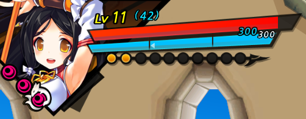

# Awakening Mode

Note: `https://elwiki.net/w/Awakening` currently redirects to an unrelated skill page ("Enlightenment", an Apostasia passive). The correct page is **`Awakening_Mode`**.

## What it is in Elsword

From ElWiki "Awakening Mode":

- Available to all characters. While awakened, **attack power +20%** (**+30%** after Transcendence). Certain skills gain unique properties while awakened.
- **Awakening Beads:** most characters have **max 3**. A bead is generated when the **Awakening Charge gauge** fills. "The charge gauge increases each time you hit an opponent or when you are hit." Default: **100 hits dealt or 50 hits received = 1 bead** (Tips; also Statistics page). The *Awakening Charge Speed* stat (max 50%) speeds this up. Beads can also come from consumables or Fever.
- **Activation: press left CTRL** with ≥1 bead. **Consumes all beads**; you get a buff that stacks with the number of beads consumed (max 3). Stacks themselves give no extra stats; only class-specific abilities depend on stack count.
- **Duration: 30 s per bead consumed** (extendable by stat/passives). You can **re-awaken** while awakened if you have beads (all characters since 01/2024).
- **Freeze:** awakening freezes the screen briefly (~0.7 s historically; ~0.3 s since KR 07/2021). Usually grants a brief advantage; can rarely be interrupted.
- **3rd-bead appearance change:** "For characters whose 3rd awakening bead changes their appearance, their appearance will change at 3 stacks of awakening."
- Class-specific bonuses listed on the page include: "Full NF recovery and Unlimited NF on 3rd Bead Awakening for **Rena**", a Nasod Core for Raven, Berserk Mode for Chung, etc. Exceptions: Add (DP resource, toggled mode), Ain (1 bead, re-awaken to raise stage), Laby (auto-awaken), Noah (moon phases).

### Rena: Nature's Force

See [07-natures-force.md](07-natures-force.md). Awakening recovers **5 NF**; excess NF gives 15 MP each; awakening with **3 beads** keeps NF at **5 permanently** for the whole duration.

### Elsword: Way of the Sword (reference)

ElWiki "Way of the Sword": two modes, **Aura of Destruction** (default; Destruction-based skills +50% damage, Destruction commands +100%, PvE) and **Aura of Vitality** (+20% action/move speed, Vitality skills -30% MP cost, **MP gain when attacked +100%**, Vitality command/skill MP recovery per hit +100%). Switch with **[V]** (special action key), 1 s cooldown. History: originally a non-segmented meter you filled with the opposite aura's attacks; 2019-2025 a 10-bar segmented meter; since KR 03/2025 the gauge is removed and modes switch freely. Every command/skill is tagged Destruction or Vitality (big tables on the page).

### Ara: Eun Mode (nine-tailed fox)

ElWiki "Ara" / "Eun's Power": "Ara has a special 3rd bead awakening, where she becomes possessed by the Nine Tailed Fox; Eun, entering **Eun Mode**" (KR: Celestial Fox Mode). Her 3rd bead icon shows "a white fox with multiple tails". In Eun Mode: hairstyle changes and **9 spectral tails** appear; accessories are hidden; battle stance changes; standard awakening damage, All Speed/Critical up; **regenerates 1 Energy orb** per enemy defeated or per **6 command/Active hits** (short internal cooldown between counted hits), and heals ~2% HP per kill. Awakening also refills Energy by stage (3 / 6 / 10 orbs for 1st/2nd/3rd stage, since 2015).

Pattern Asty likes: **awakening = temporary transformation + the class resource goes "unlimited" or accelerates.**

## Why Asty loves it

> "What I also love is the 'Awakening' feature, that's composed of 3 'levels' and level 3 booster (can enter Awakening mode by pressing Ctrl key on Windows, Cmd on Mac) has special effects depending on the character/class we play (like Ara... changes her appearance in 9-tailed fox and her spells have special passives triggering related to her orbs system etc.)."

## What our version must do (acceptance criteria)

- [ ] Awakening gauge per player: +1 unit per hit dealt, +2 per hit received (gives Elsword's 100 dealt / 50 received per bead), values in data. Max 3 beads.
- [ ] Awakening key: physical **Left Ctrl** on all platforms by default; on macOS also allow **Left Cmd** (see open question 1). Consumes all beads; duration = 30 s × beads (data); +20% damage (data).
- [ ] Re-awaken allowed while awakened if beads ≥ 1 (adds duration and stack).
- [ ] Awakening activation: short freeze (~0.3 s, data) + flash VFX; character is invulnerable during the freeze (our decision; Elsword "can rarely be interrupted").
- [ ] 3-stack awakening triggers a **visual transformation** hook (model/material swap or overlay VFX) and a class hook `on_awaken(stacks)` used by Nature's Force.
- [ ] UI: 3 bead icons + charge gauge next to the portrait.
- [ ] Co-op ready: awakening is an input command processed by the simulation like any move (not a UI-side effect).

## Open questions

1. **Cmd on macOS conflicts**: Cmd+Q quits, Cmd+W closes the window, Cmd+H hides. On AZERTY, the physical key for `Z` is labeled **W**, so holding Cmd while pressing the attack key = **Cmd+W**. Proposal: default **Left Ctrl** on macOS too, offer Cmd as opt-in, and when Cmd is bound, the game must swallow Cmd+W/Cmd+Q while in fullscreen gameplay (needs testing with the chosen windowing library).
2. Do we want Elsword's original "awakening only" (no class system) for the M4 cut, then Nature's Force as M4.5?
3. What is our Rena-like character's 3-bead transformation look? (Elsword Rena's is mostly a weapon/aura change; Ara's is a full fox form.) Asty likes the transformation idea, so plan for a visible change.

## Sources

- https://elwiki.net/w/Awakening_Mode
- https://elwiki.net/w/Statistics (Awakening Charge Speed: 100 hits / 50 received per bead)
- https://elwiki.net/w/Nature%27s_Force_System
- https://elwiki.net/w/Way_of_the_Sword
- https://elwiki.net/w/Eun%27s_Power
- https://elwiki.net/w/Ara

## Images

| Local | What | Source |
|---|---|---|
| `../images/awakening/Awaken1.png` | Awakening beads under the portrait + gauge | https://elwiki.net/w/Awakening_Mode |
| `../images/awakening/Arabeads.png` | Ara's 3rd bead (white multi-tailed fox) | https://elwiki.net/w/Awakening_Mode |
| `../images/awakening/RavenBead.png` | Raven's 3rd bead (class-specific bead art) | https://elwiki.net/w/Awakening_Mode |
| `../images/awakening/AraPowerOfEun.png` | Ara in Eun Mode (9 tails) | https://elwiki.net/w/Eun%27s_Power |
| `../images/awakening/AraStance.png` | Eun Mode battle stance | https://elwiki.net/w/Eun%27s_Power |
| (not downloaded, 404 in archive) | Way of the Sword promo `Wayoftheswordprev.jpg` | https://elwiki.net/wiki/images/7/77/Wayoftheswordprev.jpg |

