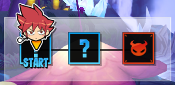
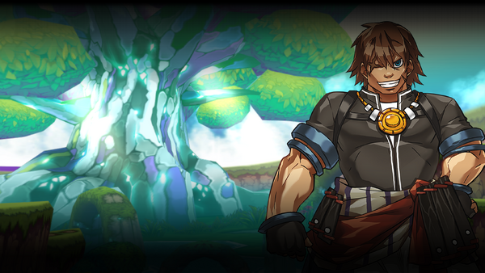

# Dungeons

> Tracking issue: [#30](https://github.com/asty8926/side-scrolling-game/issues/30) · Milestone epic: [#19](https://github.com/asty8926/side-scrolling-game/issues/19) · Research: [#33](https://github.com/asty8926/side-scrolling-game/issues/33)

## What it is in Elsword

### Structure

- "Dungeon play is the core of Elsword Online." Solo or party of **up to 4** (6 in raids). (Dungeons)
- A dungeon is a short chain of **rooms/stages** shown on a **Dungeon Layout** map: e.g. Shadow Forest = `START → ? → Boss` (image below). Rooms are connected by **doors**/portals (minimap icon "Door"; Tree of El trivia mentions "the portal effect for the room's door").
- The **minimap** in dungeons shows "the number of remaining mobs in an area"; icons exist for **Mini Boss**, **Boss** and **Door**. `M` shows the dungeon map. (UI Guide)
- Rooms are cleared by killing their mobs; **Fever** "fills up by one each time your party completes a room in a dungeon" (Fever page), which confirms rooms as the unit of progress. (The exact door-unlock rule, e.g. "all mobs dead → door opens / GO arrow", is the well-known behavior but not stated verbatim on pages read; treat as design.)
- Each dungeon page lists: description, recommended level, **Dungeon Layout** map, **Mobs** (each with named moves), **Mini Boss** (some dungeons), **Boss** (with named moves), boss intro/outro **dialogue** per character, boss drops, BGM (stage + boss track).
- Example (Shadow Forest, lvl 10-13): mobs with 1-3 moves each (e.g. "Wrathful Dryad's Spirit... Uppercut... His upper will have super armor"), **Mini Boss Kira-Kira** (3 moves), **Boss Awakened Banthus**.
- Example (Tree of El, lvl 2-3): 2 mob types (Mars: "Stick Attack"; Ruchi: "Rapid Kick"), **Boss Banthus** with 3 moves: Swing, Jumping Slash, Power Smash.

### Platforms

From ElWiki Commands: jump = "up by a single platform in height... most dungeon layouts are essentially layered in height by multiple platforms exactly one jump apart." `↓` drops through a platform. Double jumps ≈ 2 platforms (varies by character).

### Bosses

- Bosses/some monsters have **Stoic Thresholds** (hits before auto Super Armor + push-back knockdown), see [02-kd-knockdown.md](02-kd-knockdown.md).
- Reviving in a dungeon room **forcibly knocks down all enemies in the room** (Resurrection page). Elsword uses Resurrection Stones (10/day); we will not copy the economy.

### End-of-dungeon rank

**Not documented on ElWiki pages read.** Community knowledge (Reddit, forum posts; unverified):

- The results screen grades several categories, each with its own letter, and the **overall rank is derived from the category ranks, not from total score**. Categories mentioned: **Combo** (consecutive hits without interruption), **Technique** ("All combos and skills have a tech score... skills and combo hits that require you to hit more buttons / cost more mp will reward you with more tech score"; variety helps), **Damage taken / "Shot" score** (how much and how often you are hit), and **Time** (clear time) / damage dealt ("Hit score") depending on the era. A 2015 Japanese source says the current four score ranks replaced the former **time, combo, damage, technique** ranks.
- Letters seen: **SS (also shown as S+), S, A, B, C, D, F?** "There is no SSS/S++ in dungeons, only SS/S+" (forum). Full letter list **to verify**.
- Higher rank historically affected rewards (EXP/drop bonus; to verify).

## Why Asty loves it

> "I also really really love the dynamic and fast aspect of dungeons, their little platforms, their 'room' system, their mini-boss and boss system, their evaluation at the end (like S+, S, A, B, D...) to know how well we performed in the dungeon."

## What our version must do (acceptance criteria)

**Dungeon data**
- [ ] A dungeon is a data file: ordered graph of rooms (allow branches later), each room = platform layout + spawn waves + door(s) + optional mini-boss/boss flag. Editable by the dungeon editor (M2+) and by hand; hot-reloadable.
- [ ] Platform tiers are exactly **one jump** apart (shared constant with the character's jump height). Drop-through platforms vs solid ground are distinct types.
- [ ] Room flow: enter → spawn waves → door locked → all mobs dead → door unlocks (with a clear "GO →" indicator) → next room. Minimap/top HUD shows remaining mobs.
- [ ] Short rooms: target 30-90 s per room for a competent player (our pacing target).

**Monsters (M2 minimum)**
- [ ] 2 mob types (melee rusher, ranged caster) with 1-3 named moves each, telegraphed attacks, hit/hurtboxes, KD values, hitstun, and simple AI (idle, approach, attack, retreat). Monsters **attack the player** and can juggle/knock down the player.
- [ ] 1 mini-boss (3 moves) and 1 boss (3-4 moves, one with super armor; stoic threshold).
- [ ] Collision: player-monster pushboxes (no overlap except during pass moves), hitbox/hurtbox per frame, platform collision for monsters too.

**Rank**
- [ ] Results screen with per-category letters and an overall letter. Our categories (explicit formulas, unlike Elsword): **Combo** (max combo + % of hits inside combos), **Technique** (sum of per-move technique points, with diminishing returns for repeating the same move → rewards variety and the `ZZZ<<>`/`>>ZX` toolkit), **Damage taken** (hits received + HP lost), **Time** (vs par time per dungeon).
- [ ] Letters: SS (displayed "S+"), S, A, B, C, D. Thresholds per dungeon in data.
- [ ] Overall rank = rule on category letters (e.g. average of letter scores, capped by the worst category +2). Documented and unit-tested.
- [ ] Co-op ready: per-player stats tracked by the simulation; party overall rank and per-player MVP.

## Open questions

1. Rank letters: confirm Asty's memory (S+, S, A, B, D...) vs SS/S+ naming; do we show F?
2. Does rank give rewards in our game (we have little loot)? Proposal: cosmetic + best-rank record per dungeon.
3. Depth: purely 2D plane, or Elsword-like occasional multi-line "lanes"? Elsword is a single 2D plane with platforms. Proposal: single plane.
4. First dungeon theme and boss design (our IP).

## Sources

- https://elwiki.net/w/Dungeons
- https://elwiki.net/w/Tree_of_El
- https://elwiki.net/w/Shadow_Forest
- https://elwiki.net/w/Commands (platform heights)
- https://elwiki.net/w/UI_Guide (minimap, dungeon map, doors)
- https://elwiki.net/w/Fever (room completion)
- https://elwiki.net/w/Resurrection
- https://elwiki.net/w/Stoic_Thresholds
- Rank (community, unverified): https://www.reddit.com/r/elsword/comments/50sp6v/how_do_i_get_a_s_rank_in_dungeon/ , https://www.reddit.com/r/elsword/comments/pr5x7o/what_the_hell_is_technique_score/ , https://www.reddit.com/r/elsword/comments/f62dob/getting_s_ss/ , https://elsword.publog.jp/archives/32643581.html , https://www.elitepvpers.com/forum/elsword/3151826-need-help-ss-ranks.html

## Images

| Local | What | Source |
|---|---|---|
| `../images/dungeons/2-1map.png` | Shadow Forest layout: START → ? → Boss | https://elwiki.net/w/Shadow_Forest |
| `../images/dungeons/NEWTree_of_El_Map.png` | Tree of El layout | https://elwiki.net/w/Tree_of_El |
| `../images/dungeons/New2-5Map.png` | Wally's Castle layout | https://elwiki.net/w/Wally%27s_Castle |
| `../images/dungeons/1-1new2.png` | Tree of El screenshot (platform look) | https://elwiki.net/w/Tree_of_El |
| `../images/dungeons/NewKiraKira.png` | Mini-boss Kira-Kira | https://elwiki.net/w/Shadow_Forest |
| `../images/dungeons/22AwakenedBanthus.png` | Boss Awakened Banthus | https://elwiki.net/w/Shadow_Forest |
| `../images/dungeons/Minimap_Icon_-_*.png` | Minimap icons: door, mini boss, boss | https://elwiki.net/w/UI_Guide |
| `../images/dungeons/DungeonSelect.png`, `Dungeonbasics-a.png` | Dungeon select UI | UI Guide / Dungeons |
| `../images/dungeons/OldDungeonUI.jpg` | Old (2007-2009) dungeon UI | https://elwiki.net/w/UI_Guide |

