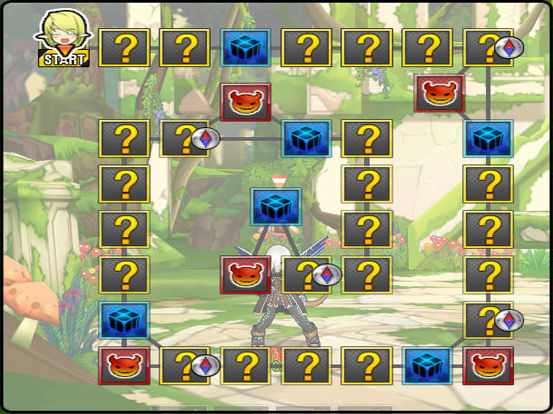

# Henir's Time and Space

## What it is in Elsword

- "A **boss rush** dungeon where players will be put up against a back to back gauntlet of boss battles with some battles featuring multiple bosses." Four versions existed (NA: v1 Feb-Oct 2012, v2 Oct 2012-Nov 2016, v3 Nov 2016-Feb 2019, v4 current since Feb 2019). Originally "Ymir's Time and Space" / "William's Time and Space".
- Lore: a place "where there is no limitation of time and space" created by the god Henir; overcoming the trial grants power.

### Version 2 (the classic one, 2012-2016)

- **Normal** vs **Challenge** mode: consumables enabled/disabled, resurrection allowed/not allowed, mounts usable/disabled; death of the party = fail.
- Boss level = average level of the party (rule on the page).
- **Boss sets by region**, each stage being a boss (often **2 copies** of the same boss), e.g. Hamel set: Stage 1 Shadow Master x2, Stage 2 Victor x2, Stage 3 Magmanta x2, Stage 4 Ran x2. Plus optional **Secret Stage** and **Elite Stage** (choose one within 10 s).
- **Rest Areas** between sets restore a fixed % of HP/MP (each subsequent one restores less) and may give a random buff.
- Some bosses behave differently in Henir: no text warnings for specials; e.g. Magmanta "will escape after 60 hits when it is not super armored."
- Rewards: Time and Space Fragments/Elements/Cores exchanged at the NPC Glave; Challenge-mode leaderboard by playtime (top 100 titles).

### Version 4 (current)

- Solo only. **Normal: 20 consecutive stages**, final boss Obezaar; **Challenge: 6 stages**; bosses picked randomly each week; resurrection not allowed; dungeon-specific consumables only.

## Why Asty loves it

> "I also really love the concept of the special dungeon called 'Henir's Time and Space'... where each room is a boss of a dungeon, but that's for later of course."

## What our version must do (acceptance criteria)

Only after we have **at least 4 bosses** from regular dungeons.

- [ ] A dungeon definition whose rooms reference **existing boss encounters** by id (no new content needed to add a stage).
- [ ] Rest room every N stages restoring a decreasing % of HP/MP; optional random buff.
- [ ] Normal (revives allowed) vs Challenge (no revive, timer leaderboard local/online).
- [ ] Timer per run and per stage; personal best saved.
- [ ] Co-op compatible (v2 allowed parties).

## Open questions

1. Party or solo (v2 party vs v4 solo)? Proposal: party, since co-op is the goal.
2. Random boss order or fixed sets?
3. Leaderboards: local only until online exists.

## Sources

- https://elwiki.net/w/Henir%27s_Time_and_Space
- https://elwiki.net/w/Henir%27s_Time_and_Space/Season_2
- https://elwiki.net/w/Henir%27s_Time_and_Space/Season_4

## Images

| Local | What | Source |
|---|---|---|
| `../images/henir/HenirMap.png` | v2 dungeon layout | Season_2 page |
| `../images/henir/RestAreaBuffs.png` | Rest Area random buffs | Season_2 page |
| `../images/henir/HenirDimensionselect.png`, `HenirSelect.png`, `HenirButton.png` | Select icons | main page |
| `../images/henir/HenirS4new.png` | v4 screenshot | Season_4 page |

