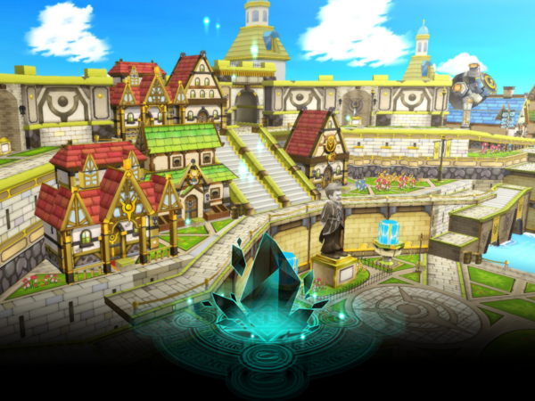
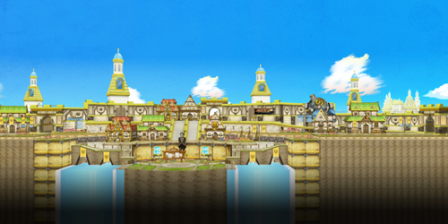

# Town: NPCs, dialogues, shops

> Tracking issue: [#31](https://github.com/asty8926/side-scrolling-game/issues/31) · Milestone epic: [#20](https://github.com/asty8926/side-scrolling-game/issues/20)

## What it is in Elsword

- Towns (villages) are walkable side-scrolling hubs between dungeons. Example **Elder Village**: "the small town situated in the northern region of Lurensia", level 6 to enter, connected `Ruben Village ← Elder Village → Wally's Memorial Bridge` (a hunting field).
- **NPC roster per town** (Elder): **Hoffman** ("Elder Village's Merchant", leader of the merchant guild), **Lenphad** ("Elder Village's Blacksmith": "Welcome to Sword Smith Cats! I'm Lenphad. We sell the best weapons around." Also enhances equipment), **Luichel** ("Elder Village's Accessory Shop", ex-thief jeweler), **Echo** (alchemist). Plus "Special NPCs" present in every town: Ariel, Camilla (PvP/sparring), Luriel, Adams, Myu.
- Each NPC page has: role, age, race, location, voice actor, background, relations, and lines. NPCs are also story actors (e.g. Hoffman greets the party and explains Banthus's heists).
- Minimap in towns shows NPCs by function icons: Board, Mailbox, Blacksmith, Alchemist, Accessory Shop, etc. (UI Guide)
- Early versions (2007-2008 KR) had **menu-based towns** (no walking): "Villages were all simply select screens" (UI Guide trivia); images below. Elder was among the first towns with 3D elements (stairs).
- Dungeons also have **dialogue**: boss intro/outro lines and per-character victory quotes (Tree of El page).
- Channels: you can switch channel "only in towns" (UI Guide). See [12-fields-channels-party.md](12-fields-channels-party.md).

## Why Asty loves it

> "...as well as a city with NPCs and their dialogs and shops." He wants **visual editors**: "dialogues with visual nodes builder", "shops".

## What our version must do (acceptance criteria)

**Town**
- [ ] One walkable town map (side-scrolling, platforms allowed), no combat, exits to the dungeon select / dungeon entrance.
- [ ] 3-4 NPCs: merchant (consumables, but **no MP potions**), blacksmith (weapon/equipment shop), accessory shop, quest/story NPC.
- [ ] Interact key (physical-position binding) opens dialogue when near an NPC; NPC name + role label above head; minimap icons by role.

**Dialogue**
- [ ] Dialogue = **node graph data** (nodes: line, choice, condition, action like `open_shop`, `give_item`, `set_flag`); stored as text so agents and diffs can read it; validated at load; hot-reloadable. Planned tool: [Dialogue Manager](https://github.com/nathanhoad/godot_dialogue_manager) (`.dialogue` text files + editor tab), see [ADR 0002](../decisions/0002-addons-and-tooling.md); re-check at M3 start.
- [ ] A **visual node editor** (M3 stretch or M3.5) that reads/writes the same files (e.g. a small Godot `GraphEdit` editor plugin on top of Dialogue Manager files). Until then, the file format + a validator + an in-game "reload dialogues" key.
- [ ] Portrait, name, typewriter text, choices with keyboard navigation.
- [ ] Localization-ready: lines referenced by key (FR/EN later; Asty is French-speaking).

**Shops**
- [ ] Shop = data (inventory list, prices, stock rules); buy/sell UI with keyboard navigation; currency counter.
- [ ] Shops are Godot Resources (`.tres`) edited in the inspector (custom inspector if the item list gets clumsy), hot-reloadable.

## Open questions

1. How much economy do we want? Proposal: one currency, equipment with few stats, consumables (HP only), cosmetic later.
2. Story/quest system scope for M3: proposal = flags + 1 "go clear the dungeon" quest.
3. Town art direction (our own IP).

## Sources

- https://elwiki.net/w/Elder_Village
- https://elwiki.net/w/NPCs
- https://elwiki.net/w/Hoffman , https://elwiki.net/w/Lenphad , https://elwiki.net/w/Luichel , https://elwiki.net/w/Echo_(NPC)
- https://elwiki.net/w/UI_Guide
- https://elwiki.net/w/Tree_of_El (dungeon dialogue)

## Images

| Local | What | Source |
|---|---|---|
| `../images/town/2-Vnew2.png` | Elder Village screenshot | https://elwiki.net/w/Elder_Village |
| `../images/town/Elder_Village_Map.png` | Elder Village map with NPCs | same |
| `../images/town/Npc_hofmann.jpg`, `Npc_lenpad.jpg`, `Npc_luichel.jpg`, `Npc_echo.jpg` | NPC portraits | same |
| `../images/town/ElderVillageMenu.jpg`, `ElderVillageMenu2.jpg` | 2007-2008 menu-based town UI | same |

